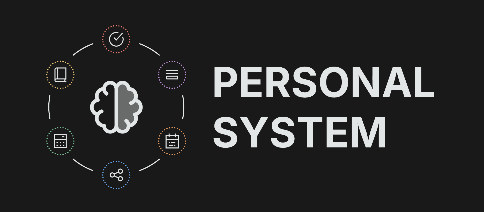

# README

---

## 1.0 Introduction

*This section provides an introduction to the system and the six areas of responsibility it divides into.*

---

### 1.1 Purpose

The Personal System is a modular workspace for managing productivity, knowledge, time, relationships, finances, and reflection. It provides a consistent structure for capturing information, turning it into useful outcomes, and reviewing progress.

---

---

The system is deliberately narrow in each of its parts and broad only in total. Every record has one correct home, and the same conventions apply everywhere.

### 1.2 System

The system is divided into six areas of responsibility, each covered by a single module. Every module owns one area of life and serves one purpose.

Each area is a way of thinking on paper. Together they externalize thought, turning what would otherwise stay in the head into information that can be held, worked with, and returned to.

| **Area** | **Module** | **Purpose** |
| --- | --- | --- |
| **Productivity** | **Agenda** | Converts priorities into actionable daily work. |
| **Knowledge** | **Reserve** | Captures, organizes, and connects knowledge. |
| **Time** | **Schedule** | Allocates time through structured events. |
| **People** | **Network** | Tracks interactions to maintain relationships. |
| **Finance** | **Ledger** | Records financial activity to monitor wealth. |
| **Reflection** | **Journal** | Captures reflections and emotions to support insight. |

The modules are also independent. A person using only one or two modules has a working system, and the others can be adopted later without rework.

<aside>

The [Console](https://app.notion.com/p/Console-2fce31a9242180e0b9bff612ab6fa72f?pvs=21) is the home page of the system and its operational hub, where every module and area of responsibility can be accessed from one place.

</aside>

## 2.0 Architecture

*This section defines the system's building blocks and how each contributes to the whole.*

---

### 2.1 Object

The system is built from three kinds of object. Each one contains the next, and the same three apply everywhere in the system.

| Object | **Analogue** | **Definition** |
| --- | --- | --- |
| **Base** | Table | A collection of records. |
| **Record** | Row | One individual data entry in a base. |
| **Property** | Column | An attribute applied to a record. |

A base contains records, and a record is described by its properties. Every component in the system is assembled from these three, and learning them once is enough to read any part of the system.

### **2.2 Component**

Components are the working parts of the system. Each is built from objects interacting with each other, and everything in the Personal System belongs to one of three.

| **Component** | **Function** | **Role** |
| --- | --- | --- |
| **Module** | Primary | A self-contained subsystem with its own data model and features. |
| **Service** | Secondary | A database supporting overall system function. |
| **Wikipedia** | Secondary | A library of structured documents holding text, media, and data. |

Modules and their bases are the primary function of the system. They contain the data and the features, and the system is complete with modules alone.

Services and Wikipedia are secondary. Each one enhances a system that already works without it, and none of them holds data a module is responsible for.

<aside>

The [Setup](https://app.notion.com/p/Setup-2fce31a92421805999ecea42c8d0beb7?pvs=21) holds all configuration and data for the system, and is where the information behind every component can be viewed.

</aside>

## 3.0 Operation

*This section describes how the system is operated, and what each stage of the process produces.*

---

### 3.1 Capture

Every capture lands in the system inbox, a single holding place that accepts information before any decision is made about what it is or where it belongs.

<aside>

The [Desk](https://app.notion.com/p/Desk-327e31a924218086a95ae947e53f3609?pvs=21) is the implementation of the system inbox, where everything captured is entered, stored, and held until it is placed.

</aside>

There are two key views that exist in the system inbox:

- **The Record** → Every capture saved to the system.
- **The Mail** → Every system message, notifications, report, and update.

<aside>

The [Capture](https://app.notion.com/p/3dde31a9242180e8a313ee4d10f78054?pvs=21) tool is used to quickly write down information in a single action. 

</aside>

Speed is the only requirement, because a capture step that demands thought is a capture step that gets skipped.

### **3.2 Place**

Place is the decision of where a captured record belongs. It can go two ways:

- **Move** → The record is moved into a specific base and becomes a record of that base's kind.
- **Create** → Some or all of the record’s information is used to create a new record in another base.

Either path ends the same way, with the information live in the system and correctly placed.

### **3.3 Execute**

Execute is active work on records, with the objective of completing them on their specified date. 

A record is complete when its status is set to done (clsoed). Execution changes a record's status rather than removing it, so the system accumulates history instead of emptying.

Each module provides its own front-end for this work. These interfaces hold the tools for triaging and managing records, so that execution and completion can be carried out in one place.

### 3.4 Analyze

Analyze is where completed and past-dated records are referenced and reviewed. Each module's metrics are derived from its complete records, and reading them back in aggregate reveals patterns that no single record shows.

Analysis is what makes the process a loop. The conclusions it produces drive future decisions and actions taken in the system.